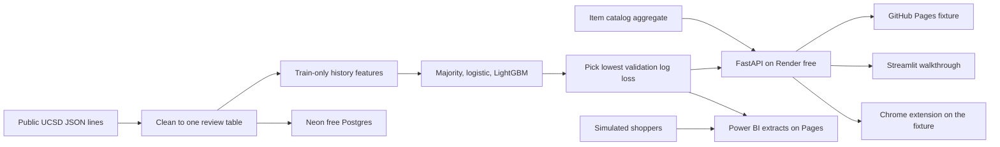

# fit-finder

Apparel size-and-fit recommendation prototype. It predicts whether a reviewed size will come back as small, fit, or large, with a calibrated confidence, and it ranks similar items by historical fit rate. A guided Streamlit tour walks a hiring manager through one size decision. A FastAPI service and a fixture page deliver the score. A Power BI build guide sits on top of held-out scores and a simulated shopper experiment. Hosting is in `docs/HOSTING.md`. The layout audit is `docs/UI_AUDIT.md`.

This is a public portfolio project for product, program, and analytics roles. It has not been used by shoppers, and it has not run on a retail site.

## What is real, and what is simulated

Real, from the public UCSD Rent the Runway and ModCloth fit reviews, scored on a held-out split:

- Fit-class log loss, accuracy, macro F1, and calibration error.
- Directional accuracy of the size suggestion.
- Content-ranker hit rate on held-out reviews that said the item fit.

Simulated, and labeled as simulated wherever the number appears:

- Shopper sessions, clicks, the recommendations-versus-none experiment, and the illustrative dollar figure.
- The H&M comparison, which runs on a synthetic purchase fixture. The Kaggle file is not downloaded. Its license is non-commercial and academic research, with no redistribution, so the public API does not serve it.

The model does not predict returns. Those datasets do not have a return flag. "Fit" is the reviewer's word.

Numbers in `docs/MODEL_CARD.md`, `docs/EVAL_REPORT.md`, and `docs/RESUME_BULLETS.md` are written by `scripts/build_metrics.py` from `docs/metrics/*.json`.

## Architecture



The extension reads the demo page only. It is not registered for retailer hosts. CI still trains on the synthetic fixture and does not download the lab files.

## Quickstart

```bash
python -m pip install -e ".[dev]"
python -m pytest
streamlit run streamlit_app.py
```

The app is a guided tour. Walk it in order. Each step says what fit-finder is doing, why, and what to look at. The buttons are the suggested prompts. Next and Back stay in that order. Free explore is the last step, and it is also the sidebar toggle.

1. The question. Start with the Rivet dress, size 8. A gown in size 4 and a top in size 12 are the other prompts.
2. The reviews. The live count comes from Neon through the Render API when that service is awake.
3. The size she is considering. Score that size, or try one two steps away. The next step rescores.
4. The size call. Class, confidence, and the suggested size.
5. Similar items. Historical fit rate in that category.
6. Was the model any good. Held-out log loss, and the directional caveat.
7. What is simulated. The experiment, the H&M fixture, and the Power BI limit.
8. The recommendation. Then open free explore to type another size.

`fit-finder-api` is still the service. It listens on `127.0.0.1:8000` when `PORT` is unset. The tour calls `FIT_FINDER_PUBLIC_API_URL` when that is set, otherwise the origin in `deploy/public.json` (`https://fit-finder-27yw.onrender.com`). `FIT_FINDER_GUIDE_BACKEND=public_artifact` stays on the committed files. `FIT_FINDER_GUIDE_BACKEND=synthetic` is the CI fixture, and the banner says so. The synthetic fixture is not the hosted table.

The free Render instance sleeps after 15 idle minutes. The tour says it is waking the free server, which takes about a minute. If the API does not answer, the tour uses the committed public-review artifact. It does not switch to the synthetic fixture on its own.

The page the extension reads is still the fixture. From `demo-store`:

```bash
python -m http.server 8080
```

Open `http://127.0.0.1:8080/`. On localhost that page calls the local API. The public fixture is `https://neelsrejan.github.io/fit-finder/demo/`. The hiring-manager tour is the Streamlit app. After Streamlit Community Cloud is connected from `main`, its URL is the one that deploy prints. The main file is `streamlit_app.py`. No secret is required in the Streamlit app. The Neon URL stays on Render.

Download the public reviews and, when `FIT_FINDER_DATABASE_URL` is set, load them into Neon:

```bash
fit-finder-pipeline
```

Raw files land in `data/raw/` and are gitignored. The committed fixture is `data/fixtures/reviews.csv`, which is synthetic and is what CI trains on. The pipeline refuses to publish that fixture as the hosted table.

Rebuild the held-out metrics from the cleaned parquet:

```bash
python scripts/build_metrics.py
```

## Learning site

Session pages, line-by-line walkthroughs, and architecture quizzes live in `academy/`. See `academy/README.md`. The Pages workflow deploys the site from `main`.

## What is blocked on Neel

The full checklist, with free-tier limits, is `docs/HOSTING.md`.

| Block | What he needs to do |
|---|---|
| Render API | Live at `https://fit-finder-27yw.onrender.com` on the free plan. `/health` is the health check. Do not add a credit card. |
| Neon database | Loaded. `GET /data/profile` reports 275,334 hosted rows from the public UCSD files. The connection string stays in `FIT_FINDER_DATABASE_URL` on Render, not in git. |
| GitHub Pages, if the workflow has not been enabled | Settings → Pages → Build and deployment → GitHub Actions. The workflow is `.github/workflows/pages.yml`. The URL will be `https://neelsrejan.github.io/fit-finder/`. |
| Power BI public report | Not available on the free license. Follow `analytics/powerbi/BUILD.md` for a private My workspace view. The public files are the CSV extracts. The Streamlit tour links to them. It is not a second dashboard. |
| Streamlit Community Cloud | Sign in at [share.streamlit.io](https://share.streamlit.io) with GitHub. Deploy this repo from `main`. Main file: `streamlit_app.py`. Leave secrets empty. Do not paste `FIT_FINDER_DATABASE_URL`. The tour reads Neon through the Render API. |
| H&M purchase file | Not part of the public API. The license is non-commercial and academic research, with no redistribution. The comparison uses `SyntheticHMSource`. |

## Layout

- `src/fit_finder/data` cleans the two UCSD files into one table.
- `src/fit_finder/model` trains the baseline, logistic regression, and LightGBM.
- `src/fit_finder/recommend` ranks items by fit rate and size closeness.
- `src/fit_finder/api` is the FastAPI service.
- `src/fit_finder/store.py` loads the cleaned public table into Neon when `FIT_FINDER_DATABASE_URL` is set.
- `src/fit_finder/events` is the simulated experiment. Demo events go to Neon when the URL is set, and to a local file otherwise.
- `src/fit_finder/hm` is the purchase-history adapter. The public path is closed on the license. The Kaggle download stays behind the allow flag for a private run.
- `app/streamlit_app.py` is the guided tour. `streamlit_app.py` is the Community Cloud entry.
- `extension/` and `demo-store/` are the fixture the extension is allowed to read.
- `analytics/` is the Power BI star schema, DAX, and build guide.
- `docs/` holds the PRD, model card, eval report, and resume bullets.

## License

Code is MIT. Dataset terms are in `DATA_LICENSES.md`.
