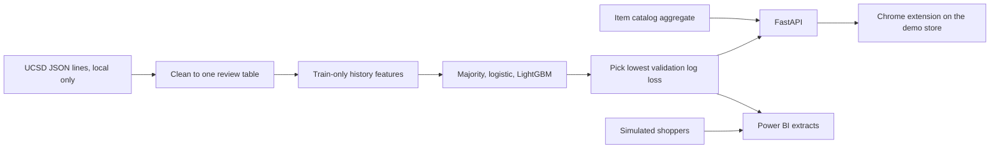

# fit-finder

Apparel size-and-fit recommendation prototype. It predicts whether a reviewed size will come back as small, fit, or large, with a calibrated confidence, and it ranks similar items by historical fit rate. A local API and a Chrome extension deliver it on a bundled demo store. A Power BI build guide sits on top of held-out scores and a simulated shopper experiment.

This is a public portfolio project for product, program, and analytics roles. It has not been used by shoppers, and it has not run on a retail site.

## What is real, and what is simulated

Real, from the public UCSD Rent the Runway and ModCloth fit reviews, scored on a held-out split:

- Fit-class log loss, accuracy, macro F1, and calibration error.
- Directional accuracy of the size suggestion.
- Content-ranker hit rate on held-out reviews that said the item fit.

Simulated, and labeled as simulated wherever the number appears:

- Shopper sessions, clicks, the recommendations-versus-none experiment, and the illustrative dollar figure.
- The H&M comparison, which runs on a synthetic purchase fixture because the Kaggle file was not downloaded.

The model does not predict returns. Those datasets do not have a return flag. "Fit" is the reviewer's word.

Numbers in `docs/MODEL_CARD.md`, `docs/EVAL_REPORT.md`, and `docs/RESUME_BULLETS.md` are written by `scripts/build_metrics.py` from `docs/metrics/*.json`.

## Architecture



The extension reads the demo page only. It is not registered for retailer hosts.

## Quickstart

```bash
python -m pip install -e ".[dev]"
python -m pytest
fit-finder-api
```

In another shell, from `demo-store`:

```bash
python -m http.server 8080
```

Open `http://127.0.0.1:8080/`. Load `extension/` as an unpacked extension in Chrome. The panel calls `http://127.0.0.1:8000`.

OpenAPI docs: `http://127.0.0.1:8000/docs`.

Rebuild the held-out metrics after a local download of the UCSD files:

```bash
python scripts/build_metrics.py
```

Raw files land in `data/raw/` and are gitignored. The committed fixture is `data/fixtures/reviews.csv`, which is synthetic and is what CI trains on.

## Learning site

Session pages, line-by-line walkthroughs, and architecture quizzes live in `academy/`. See `academy/README.md`. The Pages workflow deploys the site from `main`.

## What is blocked on Neel

| Block | What he needs to do |
|---|---|
| H&M purchase file | Accept the Kaggle competition rules for `h-and-m-personalized-fashion-recommendations`, create an API token, and export `KAGGLE_USERNAME` and `KAGGLE_KEY`. Then set `FIT_FINDER_ALLOW_KAGGLE_DOWNLOAD=1` and run `python -c "from pathlib import Path; from fit_finder.hm.adapter import download_kaggle; download_kaggle(Path('data/raw/hm'))"`. Until then the comparison uses `SyntheticHMSource`. |
| Power BI .pbix and publish-to-web | On a Windows laptop, follow `analytics/powerbi/BUILD.md` and sign in with a free Microsoft account. Publish-to-web is a Power BI service step. The repo cannot do it. |
| GitHub Pages, if the workflow has not been enabled | Settings → Pages → Build and deployment → GitHub Actions. The workflow is `.github/workflows/pages.yml`. The URL will be `https://neelsrejan.github.io/fit-finder/`. |

## Layout

- `src/fit_finder/data` cleans the two UCSD files into one table.
- `src/fit_finder/model` trains the baseline, logistic regression, and LightGBM.
- `src/fit_finder/recommend` ranks items by fit rate and size closeness.
- `src/fit_finder/api` is the FastAPI service.
- `src/fit_finder/events` is the simulated experiment and the local event log.
- `src/fit_finder/hm` is the purchase-history adapter. The Kaggle path is closed.
- `extension/` and `demo-store/` are the browser demo.
- `analytics/` is the Power BI star schema, DAX, and build guide.
- `docs/` holds the PRD, model card, eval report, and resume bullets.

## License

Code is MIT. Dataset terms are in `DATA_LICENSES.md`.
